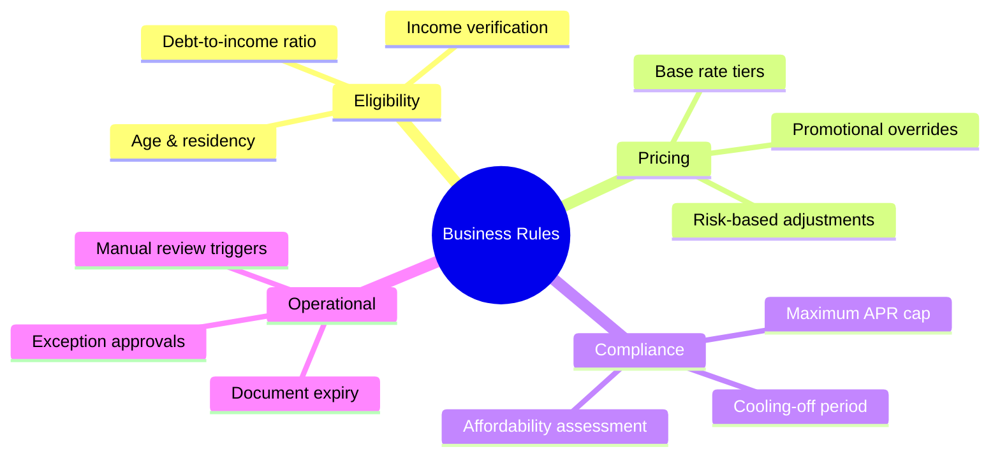

# Domain Overview — Financial Business Rules

## 1. Executive Summary

Financial institutions encode thousands of operational and regulatory constraints as **business rules**: loan eligibility thresholds, overdraft limits, fee waivers, AML hold triggers, and payment routing logic. Poorly documented rules create compliance risk, inconsistent customer outcomes, and expensive rework.

This analysis focuses on a **retail lending rules engine** initiative at a fictional neobank ("NovaPay Bank") migrating from spreadsheet-based policy interpretation to a governed, auditable rules platform.

## 2. Business Context

| Dimension | Detail |
|-----------|--------|
| **Product** | Unsecured personal loans (€1,000 – €50,000) |
| **Channels** | Mobile app, web, branch-assisted |
| **Regulatory scope** | EU Consumer Credit Directive, local responsible lending codes |
| **Systems** | Core banking, CRM, credit bureau API, rules engine (target) |

## 3. Rule Categories

## 4. Key Actors

| Actor | Role |
|-------|------|
| **Customer** | Applies for loan; subject to rule outcomes |
| **Loan Officer** | Handles exceptions and manual review queue |
| **Risk Analyst** | Defines and approves rule changes |
| **Compliance Officer** | Validates regulatory alignment |
| **BA / Product Owner** | Translates policy into requirements |
| **Rules Engine** | Evaluates rules at application time |

## 5. Problem Statement

Today, lending policy updates require **3–6 weeks** to reach production because:

1. Policy documents are ambiguous ("reasonable income" without thresholds).
2. Rules live in developer code with no business-readable catalog.
3. Audit trails cannot prove which rule version applied to a given application.
4. A/B testing of policy changes is impossible without redeployment.

## 6. Success Criteria

- 90% of eligibility rules business-readable and version-controlled within 6 months.
- Rule change lead time reduced from 4 weeks to 5 business days.
- 100% of declined applications linked to specific rule ID and version.
- Zero regulatory findings related to undocumented lending criteria in next audit.

## 7. Out of Scope

- Credit scoring model development (handled by Data Science).
- Collections and recovery rules.
- Mortgage and secured lending products.
