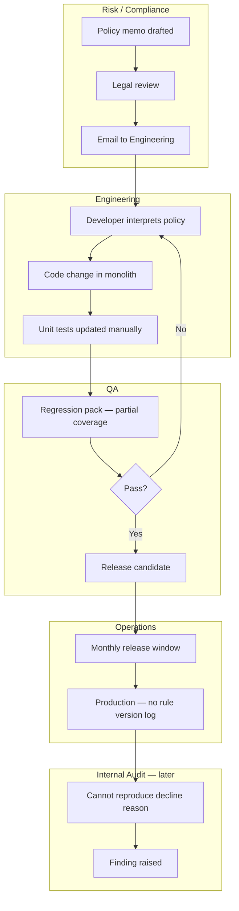

# As-Is Process Analysis — Rule Change Lifecycle

## 1. Current State Summary

Policy changes originate in Risk/Compliance documents. Engineering interprets them into hard-coded `if/else` logic. Testing is ad hoc. Production deployments bundle multiple unrelated rule changes.

## 2. Swimlane Diagram

## 3. Pain Points

| ID | Pain Point | Impact | Frequency |
|----|------------|--------|-----------|
| PP-01 | Policy ambiguity requires developer judgment | Inconsistent declines across channels | Every release |
| PP-02 | No rule catalog visible to business | Risk cannot self-serve impact analysis | Ongoing |
| PP-03 | Bundled releases obscure causality | Rollback affects unrelated rules | Quarterly |
| PP-04 | Missing version linkage on applications | Audit remediation cost | Annual audit |
| PP-05 | Branch staff override rules without trace | Compliance exposure | Weekly |

## 4. Root Cause Analysis (5 Whys — PP-04)

1. **Why** can't audit reproduce decline reasons? → Application record lacks rule version.
2. **Why** no version stored? → Engine doesn't expose version metadata.
3. **Why** no metadata? → Rules embedded in application service, not engine.
4. **Why** embedded? → No business case for rules platform historically.
5. **Why** no platform? → Policy changes were infrequent until digital growth accelerated.

## 5. To-Be Direction (Summary)

Centralize rules in a governed engine with:

- Business-readable rule definitions (DMN/decision tables).
- Versioned deployments with effective dates.
- API returning `ruleId`, `ruleVersion`, and `outcome` on every evaluation.
- Change workflow: draft → compliance sign-off → sandbox test → promote.

Detailed requirements are in the [BRD](03-business-requirements-document.md).
