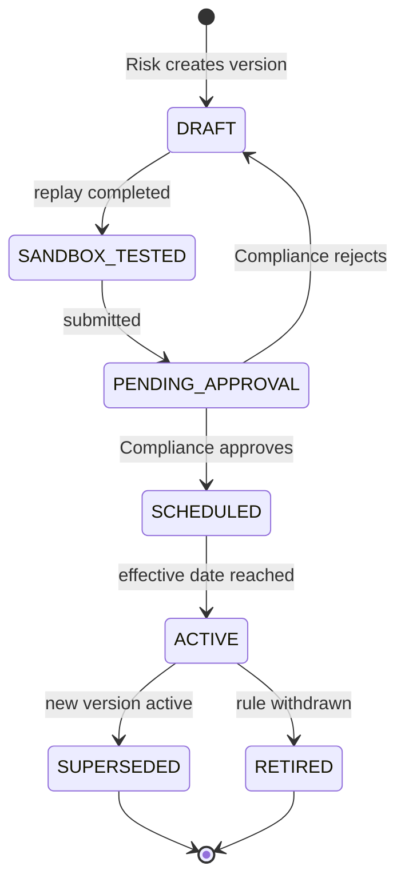
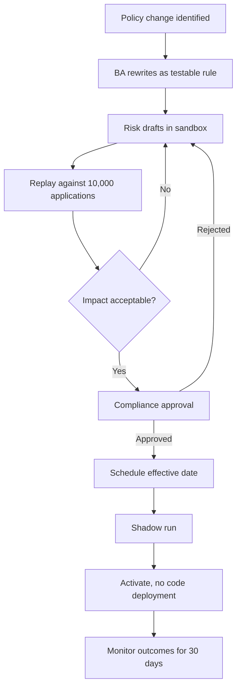

# To-Be Process Design: NovaPay Lending Rules Engine

Extends the [BRD](03-business-requirements-document.md). The approved BRD stays as the baseline; the change requests below record defects found when the rule catalog was tested for completeness and consistency.

## 1. Rule Catalog Review Findings

| ID | Type | Finding | Evidence | Resolution |
|----|------|---------|----------|------------|
| F-01 | Logic | REFER is treated as terminal, so an applicant referred at BR-003 is never checked against the decline rules that follow | FR-01, Glossary | CR-01 |
| F-02 | Overlap | DTI of exactly 0.35 meets both "0.35 to 0.45" and "up to 0.35" | BR-004 | CR-02 |
| F-03 | Ambiguity | DTI rounding is not defined, so 0.35004 could pass or fail | BR-004 | CR-02 |
| F-04 | Structure | BR-006 hides the overall APPROVE outcome inside a delinquency rule, so rule changes can affect approval by accident | BR-006 | CR-03 |
| F-05 | Gap | No rule for missing data, such as a bureau no-hit or a failed income check | BR-003, BR-005 | CR-04 |
| F-06 | Ambiguity | Age has no reference date | BR-001 | CR-05 |
| F-07 | Ambiguity | The time zone of an effective date is not stated | FR-03, US-002 | CR-06 |

## 2. Change Requests

| CR | Rule or Requirement | Statement |
|----|---------------------|-----------|
| CR-01 | FR-01 (amended) | All rules SHALL be evaluated. DECLINE is the only outcome that stops evaluation. The final result follows the priority DECLINE, then REFER, then APPROVE. |
| CR-02 | BR-004 (amended) | DTI SHALL be rounded half-up to 4 decimals. Bands: up to 0.3500 continue; above 0.3500 up to 0.4500 REFER; above 0.4500 DECLINE. |
| CR-03 | BR-006 (amended), BR-007 | BR-006 SHALL return only DECLINE or continue. BR-007 derives the final outcome. |
| CR-04 | BR-008 | If a mandatory input is unavailable, the outcome SHALL be REFER with reason `DATA_UNAVAILABLE`. |
| CR-05 | BR-001 (amended) | Age SHALL be calculated at `submittedAt`. |
| CR-06 | FR-03 (amended) | Effective dates SHALL be interpreted in Europe/Berlin local time and stored in UTC. |

## 3. Eligibility Decision Table (DMN)

Hit policy: **Priority**, with DECLINE above REFER above APPROVE.

| Rule | Input | Condition | Outcome | Reason |
|------|-------|-----------|---------|--------|
| BR-001 | Age | Below 18 | DECLINE | `AGE_MIN` |
| BR-002 | Residence | Not DE, AT, NL | DECLINE | `RESIDENCY` |
| BR-003a | Income | Below 1,500 | DECLINE | `INCOME_MIN` |
| BR-003b | Income | 1,500 up to but not including 2,500 | REFER | `INCOME_BORDERLINE` |
| BR-004a | DTI | Above 0.4500 | DECLINE | `DTI_MAX` |
| BR-004b | DTI | Above 0.3500 up to 0.4500 | REFER | `DTI_BORDERLINE` |
| BR-005a | Score | Below 520 | DECLINE | `BUREAU_SCORE` |
| BR-005b | Score | 520 to 599 | REFER | `BUREAU_BORDERLINE` |
| BR-006 | Delinquency | 30 DPD or worse in 12 months | DECLINE | `DELINQUENCY` |
| BR-007 | All | No DECLINE or REFER hit | APPROVE | none |
| BR-008 | Any mandatory | Value unavailable | REFER | `DATA_UNAVAILABLE` |

## 4. Rule Lifecycle

## 5. To-Be Change Process

## 6. From Policy Wording to a Testable Rule

| Policy wording | Problem | Rule after workshop |
|----------------|---------|---------------------|
| "Applicants must have a reasonable income" | No threshold | Verified net income of at least EUR 1,500 a month |
| "Verified income" | Source not stated | Open banking feed, or payslip OCR with confidence of at least 0.92 |
| "No recent arrears" | "Recent" and "arrears" undefined | No tradeline at 30 DPD or worse in the last 12 months |
| "Customers should be adults" | Date of assessment missing | Age 18 or over at `submittedAt` |
| "Not over-indebted" | Not measurable | DTI up to 0.4500, referral above 0.3500 |

## 7. Rule Metadata

| Attribute | Purpose |
|-----------|---------|
| `ruleId`, `version` | Identity, immutable once active |
| `policyReference` | Link to clause in the source policy |
| `owner`, `approver` | Accountability |
| `effectiveFrom`, `effectiveTo` | Version selection |
| `inputs`, `outcomes`, `reasonCodes` | Impact analysis |
| `testCaseRefs` | Traceability to test |
